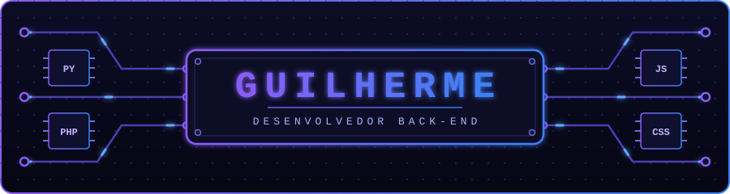
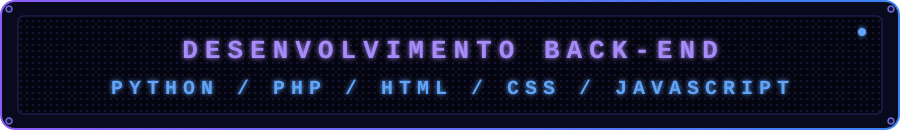
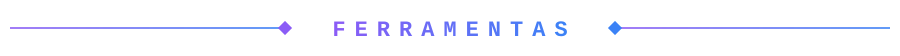
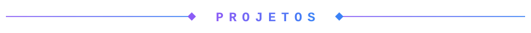
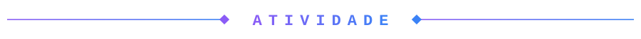

  

  

 

Desenvolvedor em formação com foco em back-end, utilizando Python e PHP, e com base em front-end com HTML, CSS e JavaScript. Tenho interesse em construir aplicações completas, da interface à lógica do servidor, com código organizado e boas práticas.

Tenho experiência em projetos acadêmicos em equipe, com versionamento em Git e GitHub, incluindo uma rede social para desenvolvedores e uma aplicação de controle financeiro com inteligência artificial integrada. Sigo aprofundando meus conhecimentos em desenvolvimento back-end.

  
  
  

 

  

 

  

### FinanceAI

Aplicação de controle financeiro com assistente de inteligência artificial integrado, que responde às dúvidas do usuário sobre as suas finanças. Projeto acadêmico.

 &nbsp; [Ver repositório](https://github.com/Guilherme170407/financeai)

### DevNetwork

Rede social voltada a desenvolvedores iniciantes, desenvolvida em equipe na disciplina de Desenvolvimento Front-End para Web. Fui responsável pela página Rede, com busca, conexões e perfis, com interações em JavaScript.

    &nbsp; [Ver repositório](https://github.com/fellipeaguiardev/ProjetodoPaulo)

 

  

  <picture>
    <source media="(prefers-color-scheme: dark)" srcset="https://raw.githubusercontent.com/Guilherme170407/Guilherme170407/output/snake-dark.svg" />
    
  </picture>

